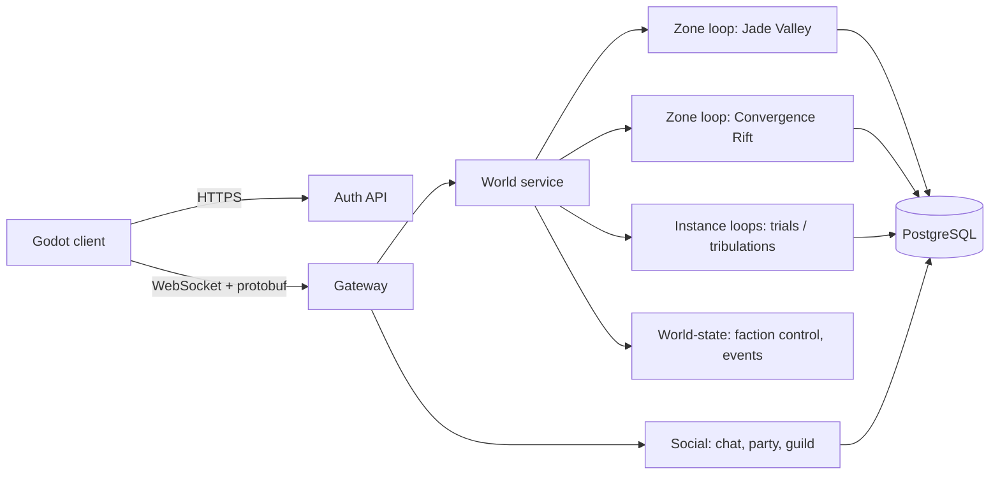

# Technical Design — Cultivation MMO (codename: *Convergence*)

> Status: **Draft v0.1** · Scope: technology only. Lore, world names, class names and
> numbers below are **placeholders** to show how the tech supports the design.

## 1. Goals and constraints

| Goal | Consequence for the tech |
|---|---|
| Three colliding worlds with *different but comparable* powers | Classes are **data**: one shared numeric baseline per archetype, flavor per world. A balance simulator checks parity. |
| 5 class trees, slightly overlapping, with specializations | Skill trees are graphs whose nodes can be shared between trees via tags. |
| Cultivation progression (realms, breakthroughs, tribulations) | Generic progression module + on-demand instanced zones. |
| World-vs-world conflict in "convergence" zones | Persistent world-state service (zone control, scheduled events). |
| Small team, fast iteration | Modular monolith in Go, scripting in Lua, hot reload, one content source of truth. |
| No exploits of the RF era (dupes, speed hacks, SQL injection) | Fully server-authoritative, item ledger, typed SQL, rate limits. |
| All game content in English | Still use string keys from day one (cheap now, expensive later). |

Initial target: **one server, 500–1,000 concurrent players**, Windows for development, Linux for hosting.

## 2. Stack at a glance

| Layer | Choice | Why |
|---|---|---|
| Client engine | **Godot 4** (latest stable, version pinned in repo) | MIT, no royalties, good 3D, fast editor. |
| Client language | **GDScript (typed)** | Fast iteration; network layer isolated so it can move to C#/GDExtension if profiling demands it. |
| Server language | **Go** (latest stable, pinned in `go.mod`) | Goroutines, fast builds, simple concurrency, proven by GoMMO. |
| Wire protocol | **Protocol Buffers** (managed with `buf`) | One schema → Go + GDScript code. Versioned, compact. |
| Transport | **WebSocket**, binary frames (`coder/websocket`) | Works through firewalls and in web exports; enough for tab-target combat. Transport is behind an interface so KCP/UDP can be added later. |
| Scripting | **Lua** via `gopher-lua` | Skills, quests, NPC AI, breakthroughs. Sandboxed, hot-reloadable. |
| Database | **PostgreSQL** + `pgx` + `goose` migrations (embedded) | Transactions for trades/market; parameterized queries only (no SQL injection). `sqlc` deferred: its PostgreSQL parser needs cgo, which the Windows dev setup lacks. |
| Cache / presence | None in v1 → **Valkey** when we split processes | Avoid infrastructure we do not need yet. |
| Message bus | None in v1 → **NATS** when zones run in separate processes | Same reason. |
| Pathfinding | Navmesh exported from Godot, A* on the server (evaluate `arl/go-detour`) | The server must validate movement and drive NPCs. |
| Observability | `log/slog`, Prometheus metrics, `pprof` | Built into Go, zero cost to start. |
| Local infra | Docker Compose (Postgres), `Taskfile` | One command to bring up the stack. |
| CI | GitHub Actions: lint, tests, content validation, proto breaking-change check | Catch broken content before it reaches a server. |

## 3. Repository layout (monorepo)

```
/proto            .proto files (single source of the wire protocol)
/content          YAML game data + Lua scripts (single source of game rules)
  /archetypes     warrior.yaml, guardian.yaml, artisan.yaml, ...
  /variants       per-world flavor of each archetype
  /skills         skill definitions (+ /scripts/*.lua)
  /realms         cultivation realms and breakthroughs
  /items /npcs /quests /zones
/server
  /cmd/server     main binary (all roles in one process for v1)
  /cmd/bot        headless bot client for load tests
  /cmd/contentc   content compiler/validator
  /cmd/balancesim combat simulator for class parity
  /internal/...   gateway, auth, world, zone, combat, progression, economy, social, persist, script
/client           Godot 4 project
/tools            map exporter (Godot editor plugin), codegen scripts
/docs             this file, ADRs
```

## 4. Server architecture

### 4.1 Process model

v1 is a **modular monolith**: one binary, clean internal module boundaries, so any module can become its own process later.



- **Auth API (HTTP):** account creation, login (Argon2id password hashes), character list. Issues a short-lived session token that the client presents to the gateway.
- **Gateway:** owns sockets. Decodes frames, applies per-connection rate limits and message size limits, routes messages to the player's current zone or to Social. Never contains game logic.
- **World service:** knows which zone each character is in, handles zone transfers and spins up instances on demand.
- **Zone loop:** the heart of the game (below).
- **Social:** chat channels, whispers, parties, guilds. Independent of zones so chat survives zone changes.
- **World-state:** persistent faction control of convergence zones, the event scheduler (invasions, rift openings), server-wide announcements.

### 4.2 Zone loop: single-threaded per zone

Each zone (and each instance) is **one goroutine that owns all its state**. No locks on game state; everything else talks to it through channels.

```go
func (z *Zone) Run(ctx context.Context) {
    ticker := time.NewTicker(50 * time.Millisecond) // 20 Hz
    defer ticker.Stop()
    for {
        select {
        case <-ctx.Done():
            z.flushAll()
            return
        case cmd := <-z.inbox: // join, leave, transfer, admin
            z.handle(cmd)
        case <-ticker.C:
            z.drainInputs()   // player intents queued by the gateway
            z.stepAI()        // Lua behaviors, budgeted per tick
            z.stepCombat()    // casts, cooldowns, damage, buffs
            z.stepMovement()  // validate against navmesh + speed limits
            z.replicate()     // send deltas to each player's interest set
            z.persistDirty()  // write-behind of changed characters
        }
    }
}
```

- **Interest management:** spatial grid (cells of ~32 m). Each player receives only entities in their own and neighboring cells. This is what keeps bandwidth flat as player count grows.
- **Replication:** spawn / despawn / delta messages, only changed fields, sent once per tick.
- **Tick budget:** each subsystem is measured per tick (Prometheus histogram). If a zone overruns, we see it before players do.
- **Scaling path:** busy zones get split into channels (copies of the same map), and later zones can move to separate processes over NATS without changing the zone code.

### 4.3 Authority and anti-cheat

The client sends **intents**, never results:

| Client sends | Server does |
|---|---|
| `MoveIntent{target, seq}` | Checks navmesh, max speed, stuns/roots; corrects the client if needed. |
| `UseSkill{skill_id, target_id}` | Checks cooldown, resource, range, line of sight, realm requirement; runs the skill. |
| `Craft{recipe_id, inputs}` | Checks inventory, skill level; transaction in DB. |

Plus: per-message-type rate limits, sequence numbers to drop replays, server-side logging of anomalies (speed, impossible damage) for review rather than instant bans.

## 5. Game systems mapped to technology

### 5.1 Classes: archetype × world variant

The "comparable but different" requirement is solved structurally:

- An **Archetype** defines the role and the numeric baseline: stat curves, damage budget per second, survivability budget, resource throughput.
- A **World Variant** defines the flavor: resource name and mechanic (e.g. Qi / Aether Charge / Divine Favor), skill pool, animations, VFX.
- **5 archetypes × 3 worlds = 15 playable classes** sharing 5 numeric baselines.

Placeholder mapping (design will replace names):

| Archetype | Jade world (cultivation) | Brass world (tech) | Myth world (gods/spirits) |
|---|---|---|---|
| Warrior (melee DPS) | Sword Cultivator | Pile-Driver | Champion |
| Guardian (tank) | Iron Body Monk | Bulwark Frame | Aegis Bearer |
| Artisan (crafter) | Alchemist / Forge Master | Engineer | Rune Smith |
| Ranger (long range) | Archer | Rail Gunner | Arcanist |
| Leader (support/control) | Formation Master | Battle Commander | Mystic |

```yaml
# content/archetypes/ranger.yaml
id: ranger
role: ranged_dps
baseline:
  hp_per_level: 42
  dps_budget: 1.00        # relative to the global reference
  survivability: 0.70
  resource_throughput: 1.00
trees: [ranger_core]
shared_nodes_with: [warrior, leader]   # the slight overlap between trees

# content/variants/brass_rail_gunner.yaml
id: brass_rail_gunner
archetype: ranger
world: brass
resource: { name: aether_charge, max: 100, regen: on_hit }
skills: [rg_overcharge_shot, rg_deploy_turret, rg_smoke_canister]
specializations: [sharpshooter, artillerist]
```

### 5.2 Skill trees and specializations

- A tree is a **directed graph of nodes** (active skills, passives, modifiers). Nodes carry tags (`melee`, `qi`, `control`, ...).
- **Overlap** = a node referenced by more than one tree, or a node unlockable by any tree that has the required tag. No special-case code.
- **Specializations** unlock at a cultivation realm and attach a sub-graph to the base tree.
- Skills are data for common cases (damage, heal, buff) and **Lua** for anything unusual:

```lua
-- content/skills/scripts/rg_overcharge_shot.lua
function on_cast(ctx)
  local charge = ctx.caster:resource("aether_charge")
  local mult = 1.0 + charge / 100
  ctx.caster:spend("aether_charge", charge)
  ctx:damage(ctx.target, ctx.skill.base_damage * mult, "piercing")
end
```

Lua runs in one sandboxed VM per zone (no `os`, `io`, `debug`), with an instruction budget per call so a broken script cannot freeze a zone.

### 5.3 Cultivation progression

- **Realms** (major stages) and **layers** (minor steps) are data. Experience fills layers; reaching the cap of a realm requires a **breakthrough**.
- A breakthrough is a scripted event, usually a **tribulation**: the world service spins up a private instance (a zone loop with its own goroutine), runs the encounter in Lua, and commits the result in a DB transaction.
- Realms gate specializations, zones and gear, and are visible to other players (nameplate aura), which is cheap to replicate as one field.

### 5.4 Convergence zones (world-vs-world)

- Zones where the three worlds overlap. World-state tracks **control percentage per faction**, persisted in Postgres.
- The **event scheduler** (cron-like, in world-state) opens rifts, triggers invasions and resolves control periods, broadcasting to all players.
- These zones get a higher player cap and are the first candidates for channel splitting.

### 5.5 Economy and crafting

- Every item is an **instance** with a UUID; stackables are rows with quantity.
- Every change goes through an **item ledger** (append-only table: who, what, from, to, why). Duplication bugs become detectable and reversible.
- Trades, market purchases and crafts are **single DB transactions**. The zone never "gives" an item before the commit succeeds.
- The Artisan archetype plugs into gathering nodes (zone entities), recipes (data) and quality rolls (server-side RNG).

### 5.6 Fate: an LLM game master (proof of concept)

Characters have **luck** (3d6+1 at creation) and **karma** (−100..100, changed by deeds). Fate turns them into events the way a tabletop GM prepares encounters ahead of the session:

```
            background (seconds)                         play (same tick)
zone ──DeckRequest──▶ Director ──▶ Ollama model     trigger: strike/kill/travel/rest/wounded
     (slots sampled                 (deepseek-v4.1-flash:cloud)     │ roll with the player's entropy
      from the player's  ◀──Deck── validate cards         ▼
      own odds)                     (fallback if invalid)   draw matching card ─▶ apply ─▶ FateEvent
```

- **The server owns the dice.** When fate strikes, fortune vs. misfortune and magnitude (1-3) come from luck and karma. The agent never decides outcomes.
- **The agent writes cards ahead of time.** For each slot the server requests (trigger, omen, magnitude), it picks one action allowed for that slot from the catalog in `content/fate.yaml` and writes the narration. Slots are sampled from the player's own distribution, so the deck covers what is likely to be drawn. Decks refill when low or when the player's situation changes (place, level, karma band).
- **Randomness from player actions.** Every MoveInput and skill use is mixed (splitmix64) into a per-player entropy stream seeded with a server secret, so rolls depend on what the player did but cannot be steered.
- **Untrusted output.** Cards are validated against the catalog and loot tables; narration is sanitized and length-limited; invalid cards and agent failures become fallback cards. Measured in the PoC: thinking disabled, about 2-4 s per 8-card deal, all cards accepted, about 80% of events using agent cards.
- **Catalog-driven.** Actions (treasure, blessing, insight, critical, weakness, vigor aura, hidden cache, spoils, ambush, mishap, fumble, enrage, ill omen) declare omen, triggers and numbers in YAML; the zone implements each kind.

PoC shortcuts to revisit: inventory is a JSONB column (moves to an item table with the ledger in M4); items have no effects yet; temporary effects are damage multipliers only.

### 5.7 Persistence strategy

- Character state lives in memory in the zone; **write-behind** every ~30 s for dirty characters, plus immediately on logout, zone transfer and any economic transaction.
- Schema managed by `goose` migrations embedded in the server binary and applied at startup; queries are hand-written, parameterized `pgx` calls in `internal/account` (revisit `sqlc` once a cgo-capable CI exists).

## 6. Content pipeline

```
YAML + Lua (/content) ──contentc──▶ validated bundle
                                    ├─ server bundle (all rules)
                                    └─ client bundle (display data only: names, icons, tooltips)
```

- `contentc` validates references (unknown skill IDs, missing icons, broken trees) and fails CI.
- The client never receives hidden data (drop tables, AI scripts, exact formulas).
- **Hot reload** in development: change a YAML or Lua file, the server reloads it without restarting.
- All player-facing strings are keys (`skill.rg_overcharge_shot.name`) resolved from an English table.

## 7. Client architecture (Godot 4)

| Autoload | Responsibility |
|---|---|
| `Net` | WebSocket connection, protobuf encode/decode, message dispatch by type, reconnect. |
| `Session` | Token, selected character, current zone. |
| `ContentDB` | Loads the client content bundle; looks up skills, items, strings. |
| `World` | Spawns/despawns replicated entities, keeps a ~100 ms interpolation buffer for remote entities. |
| `Input` | Converts input into intents; client-side prediction for the local player's movement with server reconciliation. |
| `UI` | HUD, skill bar, tree screens, chat, inventory (Control scenes). |

- **Maps** are Godot scenes. A **map exporter plugin** (in `/tools`) writes the navmesh, spawn points, gathering nodes and portals to a file the server loads, so level design happens in one place.
- **Art pipeline:** Blender → glTF → Godot. Free starting assets: Kenney and Quaternius (CC0), Mixamo animations.
- **World identity in visuals:** one shader/VFX set per world (jade Qi glow, brass/aether holograms, mythic runes), selected by the entity's world field. Same gameplay, distinct look.
- Protobuf in GDScript via our own **`tools/protoc-gen-gdscript`** (buf plugin, no Godot addon). Chosen in M0 over godobuf to keep the toolchain in Go and versioned with the repo.

## 8. Testing and tooling

- **Unit tests** for combat formulas, progression, ledger rules.
- **Lua tests** run by the same Go test runner.
- **Bot client** (`cmd/bot`): headless Go clients that log in, walk, fight and chat. Used for load tests (target: 1,000 bots on one server with stable 20 Hz) and for regression tests on the protocol.
- **Balance simulator** (`cmd/balancesim`): runs thousands of simulated fights and rotations per class variant and reports DPS/survivability against the archetype baseline. This is what keeps the three worlds "comparable".
- **Admin panel** (later): small web UI on the internal HTTP API for player lookup, ledger search, event triggering, announcements.

## 9. Roadmap

| Milestone | Deliverable |
|---|---|
| **M0 — Skeleton** ✅ | Monorepo, proto + codegen, auth, gateway, one zone; two Godot clients see each other walk on a test map. Auth is a dev login with in-memory tickets; accounts and PostgreSQL move to M1. |
| **M1 — Living zone** ✅ | Accounts and characters in PostgreSQL, interest management, NPCs with Lua AI, basic tab-target combat, persistence, bot client with combat mode. |
| **M2 — Content pipeline** | `contentc`, archetype/variant data, one class per world playable, hot reload. |
| **M3 — Cultivation** | Realms, breakthroughs, instanced tribulations, specializations. |
| **M4 — Economy** | Items, ledger, inventory, gathering, crafting, trading. |
| **M5 — Convergence** | World-state, faction control, scheduled events, guilds, chat channels. |
| **M6 — Alpha hardening** | 1,000-bot load test, balance simulator pass, admin panel, deployment on Linux. |

## 10. Open decisions

1. **Combat style:** pure tab-target (assumed here) vs. action combat. Action combat would push us to UDP and stronger lag compensation.
2. **Camera and art direction:** full 3D third-person (assumed) vs. isometric; drives art cost more than anything else.
3. **Server topology at launch:** one world with channels vs. multiple world servers.
4. **Death and PvP rules** in convergence zones (affects economy and the ledger design).
